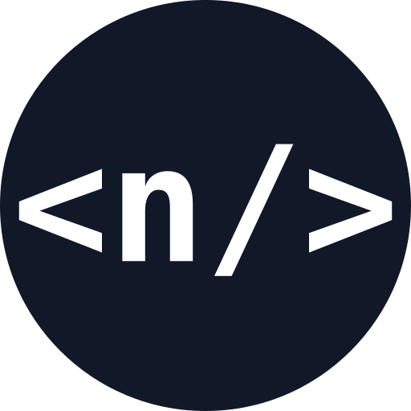

<div align="center">



# Nino Cabernard · Portfolio

**Full-stack software engineer. This site shows my work, my projects and the technologies I use.**

[](https://nino-cabernard.dev)
[](https://github.com/NinoCabernard/Portfolio-App/releases)


</div>

---

## About

This is my personal portfolio. It shows my work experience, education, side projects and skills. All content lives in JSON files in [`data/`](data/), so I can update the site without changing any components.

## Features

- **Experience timeline:** work and education side by side in one timeline, with entries you can expand
- **Project showcase:** a project overview, plus a detail page for each project
- **Tag details:** select a technology or project tag to see years of experience or a project summary
- **Responsive:** works on phones and desktops

## Getting Started

```bash
git clone https://github.com/NinoCabernard/Portfolio-App.git
cd Portfolio-App
npm install
npm run dev
```

## Deployment

Publishing a GitHub release builds a Docker image (served by nginx) and pushes it to `ghcr.io/ninocabernard/portfolio-app`.

## Contact

[](https://nino-cabernard.dev)
[](https://www.linkedin.com/in/nino-cabernard-96777a1b7/)
[](https://github.com/NinoCabernard)
[](mailto:nino.cabernard@outlook.com)
